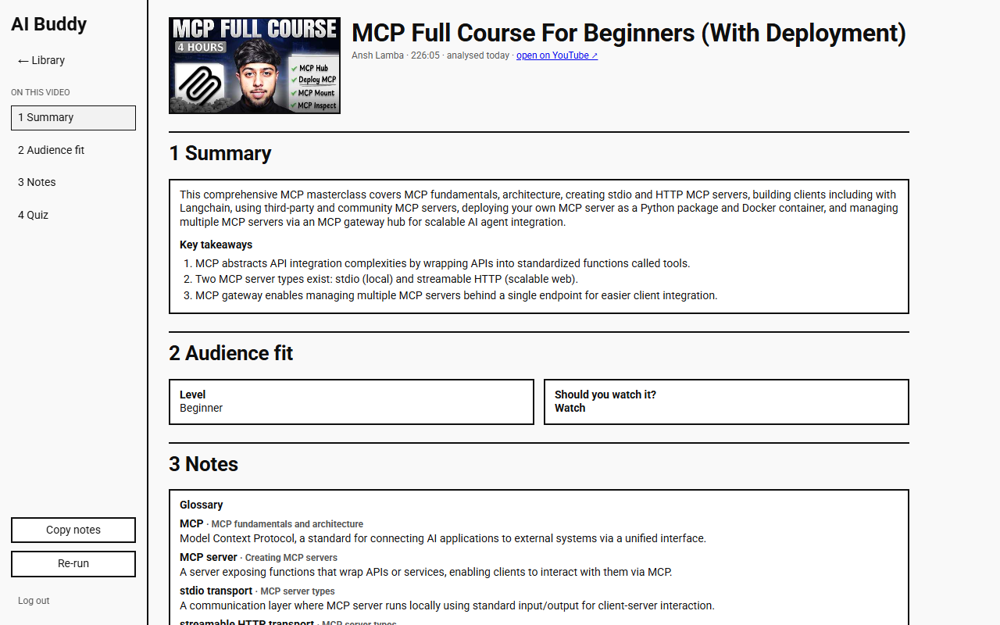
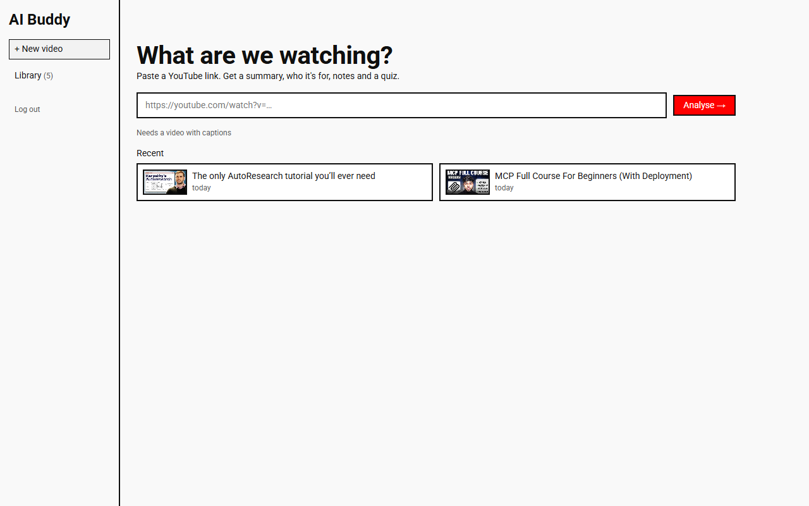
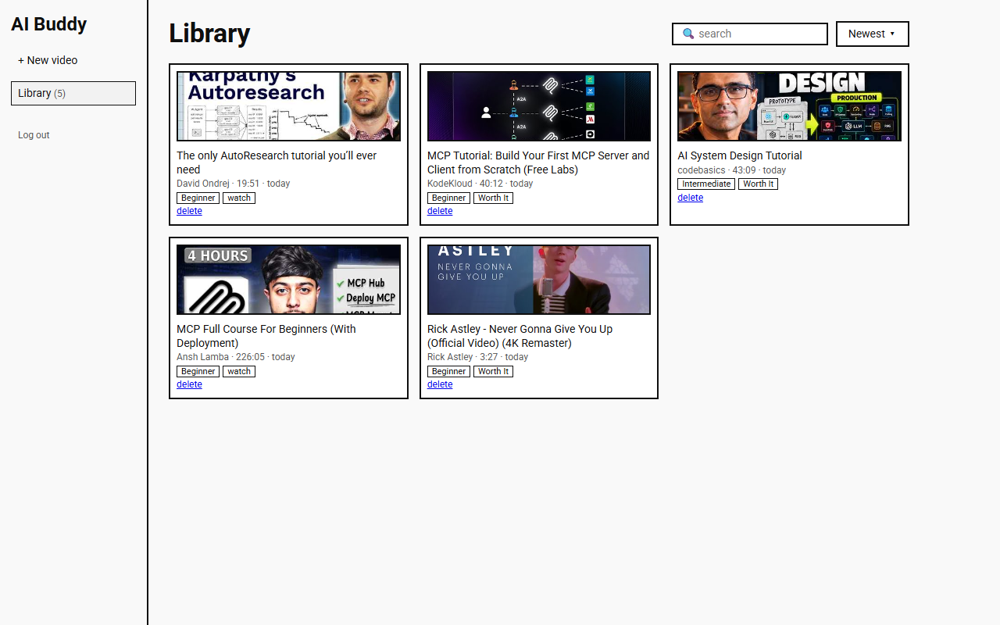
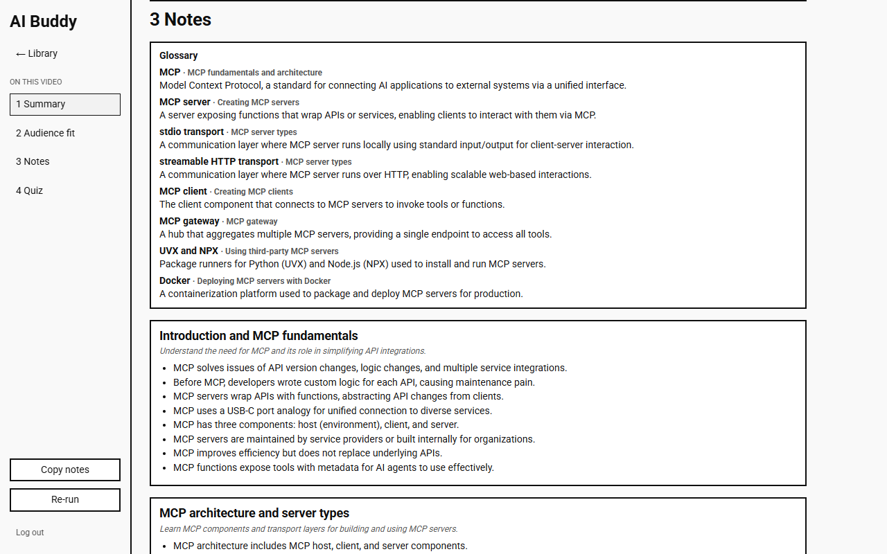
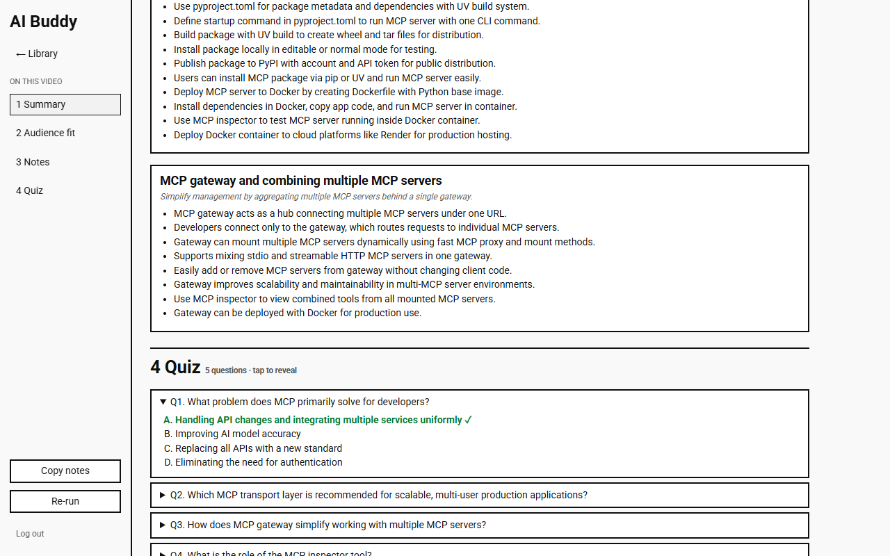
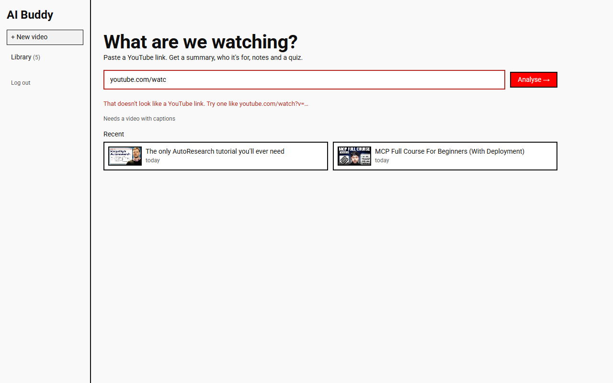
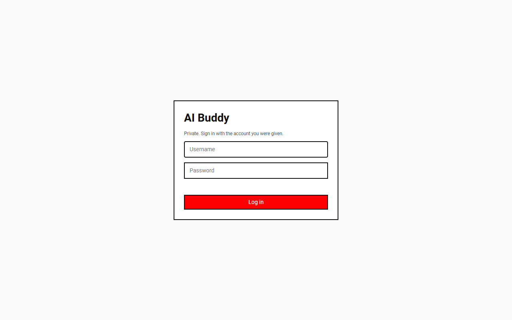

# AI Buddy — YouTube Notes Agent

Paste a YouTube link and get study notes you can read instead of watching the whole video: a summary, who it's for, a glossary, per-section notes and a multiple-choice quiz. Results stream onto the page as the model writes them.

A personal project: FastAPI + SQLite + plain HTML/JS, one Docker container, one OpenAI call per video.



## Screenshots

| | |
|---|---|
| **Home**: paste a link  | **Library**: past videos, search, sort  |
| **Notes**: glossary, then per-section "why" and bullets  | **Quiz**: tap a question to reveal the answer  |
| **Errors**: inline, with plain wording  | **Login**: only accounts you list can enter  |

## What it does

1. You paste a YouTube URL.
2. The backend fetches the transcript (`youtube-transcript-api`, with `yt-dlp` captions as a fallback) and the title, channel and thumbnail (YouTube oEmbed, no API key).
3. One streaming OpenAI call returns newline-delimited JSON, one finished object per line.
4. The page renders each line the moment it arrives, so progress is real, not a fake progress bar.
5. When the stream ends the result is saved to SQLite. If generation fails midway, what arrived is kept and shown with a Retry button.

Output sections: summary and key takeaways, level and a watch/skim/skip verdict, a glossary, per-section notes (why it matters, bullets, comparison tables and caveats only when the video has them) and a 3–5 question multiple-choice quiz.

## Quick start

Requires Docker and an OpenAI API key.

```bash
cp .env.example .env        # then edit .env (see below)
docker compose up -d --build
```

Open <http://localhost:8000> (not `0.0.0.0`) and sign in. Health check: <http://localhost:8000/health>.

After changing code, rebuild with `docker compose up -d --build`; the image bakes the code in.

## Configuration (`.env`)

| Variable | Purpose |
|---|---|
| `OPENAI_API_KEY` | Required. |
| `AUTH_USERS` | Who may log in: `name:password,name:password`. Nobody else can enter. |
| `SECRET_KEY` | Long random string used to sign login cookies. |
| `COOKIE_SECURE` | Set to `1` once served over HTTPS. |
| `OPENAI_MODEL` | Optional. Defaults to `gpt-4.1-mini` in `docker-compose.yml`. |

Generate a secret with `python -c "import secrets; print(secrets.token_urlsafe(48))"`. The app refuses everything except `/health` if `AUTH_USERS` or `SECRET_KEY` is missing.

## Access control

Every page and API route requires a login except `/health` and the login page. Sessions are a signed, HttpOnly cookie valid for 7 days. Removing a user from `AUTH_USERS` and restarting the container revokes their access. Failed logins are rate limited (5 per 15 minutes).

## API

| Route | |
|---|---|
| `GET /health` | liveness (public) |
| `POST /auth/login`, `POST /auth/logout`, `GET /auth/me` | session |
| `POST /analyze` `{url}` | streams NDJSON |
| `GET /videos`, `GET /videos/{id}`, `DELETE /videos/{id}` | library |

Error codes: `invalid_url`, `no_captions`, `unavailable`, `too_long`, `generation_failed`.

## Project layout

```
backend/    main.py (routes, streaming), auth.py, transcript.py, analyzer.py, db.py
frontend/   index.html (the app), login.html
Dockerfile, docker-compose.yml, .env.example
screenshots/
```

## Known limits

- **Personal scale.** One process, SQLite, a shared library for all users, no per-user data.
- **Very long videos.** The transcript is capped at roughly 100k tokens (about 5 hours). Longer returns `too_long`. There is no chunking.
- **Cloud hosting.** YouTube often blocks transcript requests from datacenter IPs, so this works best from a home connection. A proxy would be needed on a cloud host.
- **No HTTPS built in.** Passwords travel in clear text unless you put it behind HTTPS (set `COOKIE_SECURE=1` then).
- **No spending cap in the app.** Set a monthly limit in your OpenAI dashboard.
- **Passwords are plain text in `.env`.** Fine for a few trusted people on a private file; not for anything public.
- **No automated tests yet.**
- Videos analysed before the current notes format show less detail. Use Re-run to regenerate them.

## Status

Working end to end: login, analyse, live streaming, library, delete, re-run, retry after failure.
